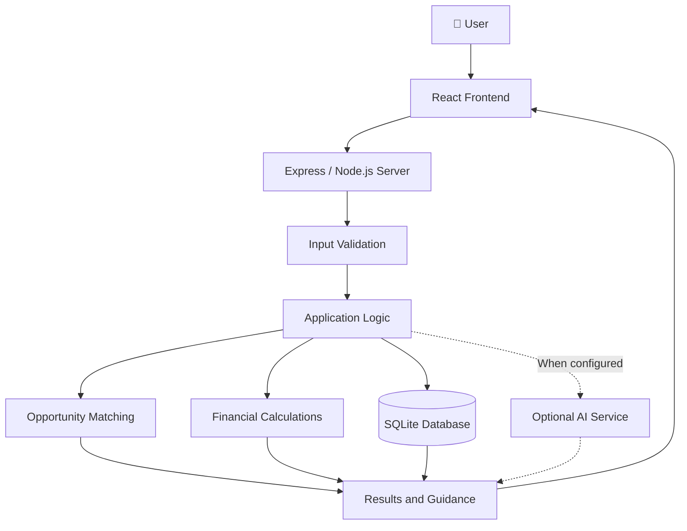

# 🌾 RuralRise AI
### AI-Assisted Rural Entrepreneurship Intelligence Platform

<p align="center">
  <strong>Turning rural business ideas into structured, informed decisions.</strong>
</p>

<p align="center">
  <a href="https://ruralrise-ai.onrender.com">🌐 Live Application</a> ·
  <a href="https://github.com/tejasrirejeti-cloud/RuralRise-AI">📂 Source Code</a> ·
  <a href="#-getting-started">🚀 Get Started</a> ·
  <a href="#-documentation">📚 Documentation</a>
</p>

<p align="center">
  
  
  
  
</p>

---

## 📑 Table of Contents

- [🌍 About the Project](#-about-the-project)
- [🎯 Problem Statement](#-problem-statement)
- [✨ Key Features](#-key-features)
- [🧠 How It Works](#-how-it-works)
- [🏗️ System Architecture](#️-system-architecture)
- [🛠️ Technology Stack](#️-technology-stack)
- [🚀 Getting Started](#-getting-started)
- [⚙️ Environment Configuration](#️-environment-configuration)
- [🧪 Testing and Verification](#-testing-and-verification)
- [🔐 Security and Data Integrity](#-security-and-data-integrity)
- [☁️ Deployment](#️-deployment)
- [📸 Screenshots](#-screenshots)
- [🗺️ Roadmap](#️-roadmap)
- [📚 Documentation](#-documentation)
- [🤝 Contributing](#-contributing)
- [👥 Project Team](#-project-team)
- [📄 License](#-license)

---

## 🌍 About the Project

**RuralRise AI** is an AI-assisted rural entrepreneurship intelligence platform designed to support people exploring business opportunities in rural communities.

The project focuses on helping users organize business ideas, evaluate financial feasibility, and explore entrepreneurship opportunities through structured application workflows.

The initial target region is **Warangal, Telangana, India**.

Rather than treating every recommendation as a verified market fact, the platform should distinguish between verified information, calculated estimates, and AI-generated suggestions wherever applicable.

### Our vision

> Make entrepreneurship planning more accessible, understandable, and evidence-aware for rural communities.

## 🎯 Problem Statement

Aspiring rural entrepreneurs may face challenges such as:

- Limited access to organized business-planning resources.
- Difficulty evaluating initial investment and expected expenses.
- Uncertainty when comparing business opportunities.
- Fragmented information about relevant resources and support.
- Difficulty translating an initial idea into a practical business plan.

RuralRise AI aims to bring relevant planning workflows together in one accessible platform.

## ✨ Key Features

The following describes the intended capabilities of the application. The availability and correctness of each feature should be confirmed against the current deployed version.

| Feature | Purpose |
|---|---|
| 💡 Business opportunity exploration | Help users explore and organize potential business ideas. |
| 🎯 Opportunity matching | Use application-defined scoring logic to compare opportunities with user inputs. |
| 💰 Financial planning | Calculate financial estimates using the inputs provided by the user. |
| 🤖 AI-assisted guidance | Support optional AI-powered functionality when configured and available. |
| 📊 Structured decision support | Present planning information in a format that helps users evaluate options. |
| 🌱 Rural entrepreneurship focus | Tailor the project to rural business-planning needs, initially focusing on Warangal. |

**Important:** Recommendations and financial projections are decision-support tools, not guarantees of profitability, loan approval, or business success.

## 🧠 How It Works

1. **Provide inputs** — The user supplies relevant information through the application.
2. **Process information** — Application logic validates and processes the submitted information.
3. **Evaluate opportunities** — The matching logic compares inputs against its defined criteria.
4. **Calculate estimates** — Financial calculations use the supplied assumptions and configured formulas.
5. **Review results** — The user reviews the available outputs and uses them to inform further research.

Actual results depend on the implemented features, valid user inputs, available data, and external service configuration.

## 🏗️ System Architecture

The following is a high-level logical architecture of the application, not a verified inventory of every implemented integration.



### Architecture overview

- **Frontend:** User-facing interface built with React and Vite.
- **Backend:** Express server running on Node.js.
- **Application logic:** Business matching and financial calculation workflows.
- **Persistence:** SQLite database.
- **Optional AI integration:** Depends on the implemented integration and its configuration.

## 🛠️ Technology Stack

| Technology | Role |
|---|---|
| React | User interface |
| Vite | Frontend development and build tooling |
| TypeScript | Typed application development where configured |
| Node.js | JavaScript runtime |
| Express.js | Backend HTTP server |
| SQLite | Relational data persistence |
| Bun / npm | Dependency and script management |
| Render | Hosted application deployment |
| Git and GitHub | Version control and source-code hosting |

See `package.json`, the lockfiles, and the source directories for the authoritative dependency list.

## 🚀 Getting Started

### Prerequisites

Install the following before running the project locally:

- [Git](https://git-scm.com/downloads)
- [Node.js](https://nodejs.org/) — use a version compatible with the project dependencies.
- [Bun](https://bun.sh/) if you want to use the project's Bun-based commands.

### 1. Clone the repository

```bash
git clone https://github.com/tejasrirejeti-cloud/RuralRise-AI.git
cd RuralRise-AI
```

### 2. Install dependencies

Using Bun:

```bash
bun install
```

Alternatively, if the npm lockfile is the authoritative lockfile for your setup:

```bash
npm ci
```

Use one package manager consistently to avoid unnecessary lockfile changes.

### 3. Configure environment variables

Review the project's environment example file, if present, and configure the required values locally.

See [Environment Configuration](#️-environment-configuration).

### 4. Build the application

```bash
bun run build
```

If the build command fails, inspect the available scripts in `package.json` and follow the scripts defined by the checked-out version.

### 5. Start the application

```bash
bun run start
```

For development, inspect `package.json` for the available development script. The exact local URL and port depend on the project's configuration.

## ⚙️ Environment Configuration

The application requires a `SESSION_SECRET` in production, according to the server's configuration.

An environment file may look like this, depending on which variables the current code requires:

```dotenv
NODE_ENV=development
SESSION_SECRET=replace-with-a-long-random-secret
```

If the application supports additional settings, configure them according to the actual source code and environment example.

**Security rules:**

- Never commit `.env` files or real credentials.
- Never publish session secrets, database credentials, or private API keys.
- Use a separate, securely generated session secret for production.
- Configure optional AI credentials only if the feature requires them.
- Keep `.env.example` limited to variable names and safe placeholder values.

## 🧪 Testing and Verification

Before using the application for real users, verify the following:

- [ ] Dependencies install successfully.
- [ ] Production build completes without errors.
- [ ] The application starts in production mode.
- [ ] The homepage and frontend assets load correctly.
- [ ] API routes return appropriate responses.
- [ ] Invalid inputs are rejected safely.
- [ ] Financial calculations are checked against known test cases.
- [ ] Matching results behave consistently for the same inputs.
- [ ] Database writes persist across application restarts.
- [ ] Authentication and session handling are tested where applicable.
- [ ] Secrets are not exposed in logs or responses.
- [ ] Error states are understandable and do not expose sensitive internals.

Do not describe a check as passed until it has actually been executed and its result recorded.

## 🔐 Security and Data Integrity

RuralRise AI should be validated for the following before a production rollout:

- **Input validation:** Reject malformed or out-of-range values.
- **Session protection:** Use secure production cookie settings and an appropriate session configuration.
- **Database safety:** Use safe database operations and validate persistence behavior.
- **Secret management:** Keep private credentials outside source control.
- **Error handling:** Avoid exposing stack traces or sensitive internal information to users.
- **Data transparency:** Clearly distinguish verified information, estimates, and generated suggestions.
- **Privacy:** Collect only necessary information and protect any personal data that the application stores.

These are verification objectives, not a claim that every security control has already passed an audit.

## ☁️ Deployment

The project is hosted on Render.

- 🌐 **Live application:** https://ruralrise-ai.onrender.com
- 📂 **GitHub source:** https://github.com/tejasrirejeti-cloud/RuralRise-AI

### Deployment checklist

1. Connect the GitHub repository to the hosting service.
2. Configure the required build and start commands.
3. Add the required production environment variables through the hosting dashboard.
4. Run the production build.
5. Check the homepage, API behavior, and application logs.
6. Configure persistent storage for SQLite if user data must survive restarts and redeployments.
7. Verify the deployment again after every relevant change.

**Data persistence note:** A deployed SQLite database must be stored on appropriately configured persistent storage if its contents need to survive instance replacement or restarts. Confirm the database path and hosting configuration before storing real user data.

## 📸 Screenshots

Screenshots of the actual application can be added here as the interface is verified.

Recommended screenshots:

- Home page and navigation
- Business opportunity workflow
- Financial planning interface
- Opportunity matching results
- Responsive mobile layout

To add a screenshot, save the image in a repository folder such as `docs/screenshots/`, then reference it:

```markdown

```

Only use screenshots of the real application. Do not present mockups as live functionality.

## 🗺️ Roadmap

The following are proposed improvements, not promises that these features are already implemented.

- [ ] Verify all primary user workflows end to end.
- [ ] Improve automated unit and integration test coverage.
- [ ] Validate financial calculations against documented test cases.
- [ ] Establish traceable sources for market-related information.
- [ ] Clearly label estimates and AI-generated recommendations.
- [ ] Verify database persistence and backup procedures.
- [ ] Complete a security review before onboarding real users.
- [ ] Improve accessibility and mobile responsiveness.
- [ ] Document the deployment and recovery procedures.

## 📚 Documentation

Useful project resources:

- [Source code](https://github.com/tejasrirejeti-cloud/RuralRise-AI)
- [Live deployment](https://ruralrise-ai.onrender.com)
- [GitHub Issues](https://github.com/tejasrirejeti-cloud/RuralRise-AI/issues)
- [GitHub repository settings](https://github.com/tejasrirejeti-cloud/RuralRise-AI)

Add links to the final project report, system architecture, API documentation, and setup guide when those documents are available in the repository.

## 🤝 Contributing

Contributions that improve reliability, accessibility, security, documentation, and test coverage are welcome.

1. Fork the repository.
2. Create a feature branch.
3. Make a focused change.
4. Run the relevant checks.
5. Submit a pull request describing the change and its verification.

Please do not include real user data, credentials, or private configuration files in issues or pull requests.

## 👩‍💻 Project Creator

**Tejasri Rejeti**  
*AIML Engineer | AI & Machine Learning Enthusiast*

Developed **RuralRise AI — AI Rural Entrepreneurship Intelligence Platform**, focused on applying AI-assisted technology to rural entrepreneurship and business planning.

- 🎓 **Institution:** Malla Reddy University, Hyderabad, Telangana, India
- 💻 **GitHub:** [@tejasrirejeti-cloud](https://github.com/tejasrirejeti-cloud)
- 🚀 **Live Application:** [RuralRise AI](https://ruralrise-ai.onrender.com)

---

<p align="center">
  Built with 💚 by <strong>Tejasri Rejeti</strong>
</p>


## 📄 License

This project includes a repository license. Refer to the [`LICENSE`](LICENSE) file for the applicable terms.

---

<p align="center">
  <strong>🌾 RuralRise AI — Supporting more informed rural entrepreneurship decisions.</strong>
</p>

<p align="center">
  Built with care for rural innovation and accessible technology.
</p>
